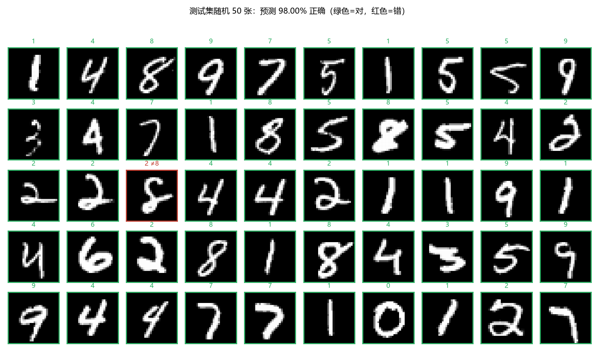
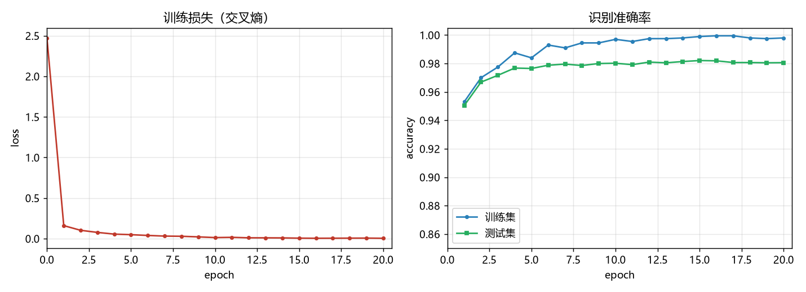

# mnist-numpy

用**纯 numpy** 手写两层神经网络做 MNIST 手写数字识别。

没有 PyTorch，没有 TensorFlow，没有 Keras —— 前向传播、反向传播、Adam 优化器全部手写，
只依赖 numpy 和 matplotlib。学习《深度学习入门：基于Python的理论与实现》（斋藤康毅）时的实践项目。



## 结果

| 指标 | 数值 |
| --- | --- |
| **测试集准确率** | **98.21%**（10000 张里错了 179 张） |
| 训练集准确率 | 99.80% |
| 网络结构 | `784 → 256 (ReLU) → 10 (Softmax)` |
| 参数量 | 203,530 |
| 训练耗时 | 20 个 epoch，约 3.7 分钟（纯 CPU） |



从混淆情况看，错得最多的是 **7**（36 张）和 **5**（22 张）—— 这两个数字写法差异大，
再加上 7 常被写成带横杠或斜得很厉害的样子，属于 MNIST 上公认的难点。相比之下 **0** 只错了 7 张。

## 快速开始

```bash
pip install -r requirements.txt

python src/train.py       # 训练（默认 20 个 epoch，约 4 分钟）
python src/predict.py     # 在测试集上评估，并生成预测样例图
```

第一次运行会自动把 MNIST 的 4 个数据文件下载到 `data/`（约 11 MB），之后完全离线可用。
数据集**不进仓库**，训练出来的参数也不进。

可选参数：

```bash
python src/train.py --epochs 30 --hidden-size 512 --lr 5e-4 --batch-size 256
python src/predict.py --rows 5 --cols 10 --seed 7
```

## 项目结构

```
mnist-numpy/
├── src/
│   ├── data.py       解析 IDX 格式、下载/缓存数据集，返回 numpy 数组
│   ├── network.py    网络本体：Affine / ReLU / SoftmaxWithLoss + Adam
│   ├── train.py      训练循环，保存测试集精度最高的那组参数
│   └── predict.py    加载参数、评估、画预测样例图
├── results/          训练曲线和预测样例图（README 用的就是这两张）
├── data/             数据集（自动下载，已 gitignore）
└── models/           训练好的参数（已 gitignore）
```

## 实现说明

**数据加载（`src/data.py`）**
自己解析 MNIST 的 IDX 二进制格式：IDX3 是 16 字节文件头 + 逐像素 uint8，IDX1 是 8 字节文件头
+ 逐样本标签，都是大端序。原来官网 `yann.lecun.com` 已经失效，改用两个可用的镜像下载。

**网络（`src/network.py`）**
按层组织，每层各自实现 `forward` / `backward`，用 `OrderedDict` 串起来，
反向传播时倒着遍历一遍就得到所有梯度：

- `Affine`：全连接层，`y = xW + b`，反向算出 `dW = xᵀ·dout`、`db = Σdout`
- `ReLU`：前向记住负值位置，反向把对应位置的梯度置零
- `SoftmaxWithLoss`：softmax 和交叉熵合在一起，反向直接得到 `(y - t) / batch_size`
  —— 这个漂亮的化简是两者组合的结果，单独求导要麻烦得多

权重用 **He 初始化**（`randn * sqrt(2/n)`），配合 ReLU 能让各层激活值的方差保持稳定；
优化器是 **Adam**，带偏置修正，学习率 1e-3。

**训练（`src/train.py`）**
mini-batch 梯度下降（batch 128），每个 epoch 结束后在固定的 2000 张训练子集和全部
10000 张测试集上评估，只保存测试集精度最高的那组参数。

## 环境

Python 3.11 + numpy 2.4.6 + matplotlib 3.11.0，Windows 11 上实测通过。
没有用到 GPU，也没有多线程。

## 数据来源

MNIST 由 Yann LeCun 等人整理（[原站](http://yann.lecun.com/exdb/mnist/)，现已失效），
本项目从以下镜像下载：

- https://ossci-datasets.s3.amazonaws.com/mnist/
- https://storage.googleapis.com/cvdf-datasets/mnist/

## 参考

- 斋藤康毅《深度学习入门：基于Python的理论与实现》

## License

MIT
